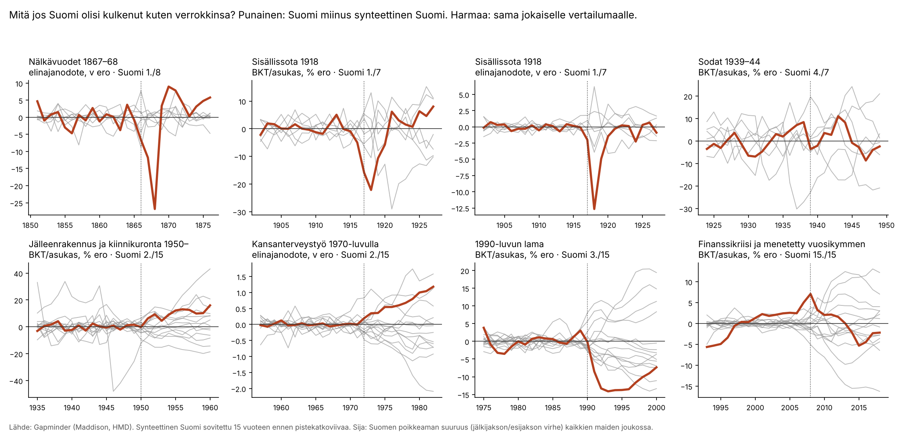

# Mitä jos -tilanteet 1850–2025

Kysymys: missä kohdissa Suomen kehitys erkani niin selvästi verrokeistaan, että voidaan kysyä
"mitä jos Suomi olisi kulkenut kuten muut"? Skriptit: `scripts/mitajos/scan.py` (skannaus ja
nimetyt tilanteet) ja `figs.py` (kuva).

## Menetelmä: synteettinen Suomi

- **Aineisto:** Gapminder fasttrack, BKT asukasta kohti ja elinajanodote. Pitkät sarjat perustuvat
  Maddisoniin ja Human Mortality Databaseen.
- **Vertailumaat:** Ruotsi, Norja, Tanska, Britannia, Alankomaat, Belgia, Ranska, Saksa, Sveitsi,
  Italia, Espanja, Portugali, Yhdysvallat ja Australia.
- **Interpoloidut vuodet jätetään pois.** Gapminder täyttää puuttuvat vuodet tasaisella kasvulla.
  Esimerkiksi Suomen BKT on täytettä ennen vuotta 1861 ja Portugalin ennen vuotta 1862.
- **Synteettinen Suomi** on vertailumaiden painotettu yhdistelmä (painot ≥ 0, summa 1). Painot
  valitaan niin, että yhdistelmä seuraa Suomen kehitystä 15 vuotta ennen tarkasteltavaa vuotta.
  Vertailu tehdään poikkeamina jakson keskiarvosta, koska Suomi oli pitkään köyhempi kuin yksikään
  vertailumaa.
- **Mitä jos -arvio** on ero Suomen ja synteettisen Suomen välillä 0–10 vuotta myöhemmin.
- **Luotettavuus:** sama laskenta tehdään jokaiselle vertailumaalle (lumekäsittely). Sija 1./N
  tarkoittaa, että Suomen poikkeama oli suurin kaikista maista. Mittarina on jälkijakson ja
  esijakson virheen suhde.
- **Tapahtumakohtaiset vertailumaat:** sisällissodassa vain ensimmäisessä maailmansodassa
  puolueettomat maat, sodissa 1939–44 maat, joissa ei käyty sotaa.

## Tilanteet

| Tilanne | Mittari | Suomen sija | Ero synteettiseen Suomeen | Tulkinta |
|---|---|---|---|---|
| Nälkävuodet 1867–68 | elinajanodote | 1./8 | −27 v (1868), +3…+9 v (1869–71) | Selvä isku, nopea palautuminen. Kuolleisuus siirtyi: heikoimmat kuolivat jo nälkävuosina. |
| Sisällissota 1918 | BKT/asukas | 1./7 | −16 % (1917), −22 % (1918), takaisin 1921 | Ero puolueettomiin maihin kurottiin kiinni kolmessa vuodessa. |
| Sisällissota 1918 | elinajanodote | 1./7 | −12,7 v (1918), takaisin 1921 | Väliaikainen isku. |
| Sodat 1939–44 | BKT/asukas | 4./7 | −4…+11 % | Ei erotu: sotaa käymättömistä maista ei saada luotettavaa verrokkia (Ruotsin paino 95 %). |
| Jälleenrakennus 1950– | BKT/asukas | 2./15 | +16 % (1960) | Suomi kasvoi verrokkejaan nopeammin. |
| Kansanterveystyö 1970-luvulla | elinajanodote | 2./15 | +1,2 v (1982) | Uusi löydös: ero kasvoi tasaisesti vuodesta 1972. Ajoitus sopii kansanterveyslakiin ja Pohjois-Karjala-projektiin (1972), mutta tämä ei ole testi. |
| 1990-luvun lama | BKT/asukas | 3./15 | −14 % (1993), −7 % (2000) | Suuri ja hitaasti kurottu ero. Kahdella vertailumaalla oli suhteellisesti yhtä suuri muutos. |
| Finanssikriisi 2008– | BKT/asukas | 15./15 | +7 % → −5 % (2015) | Ei luotettava: synteettinen Suomi ei pystynyt seuraamaan Nokia-vuosien kasvua (esijakson virhe 3,3 %). |

## Mitä skannaus löysi itsestään

- **Elinajanodote:**
  - Nälkävuodet 1858–1868 ja sisällissota 1916–1918 nousivat esiin ilman, että niitä haettiin.
  - Samoin 1970-luvun alun käänne (1968–1973) ja vuodet 1994–1995. Jälkimmäinen on pieni ero
    (+0,6 v).
- **BKT asukasta kohti:**
  - Jälleenrakennuksen kasvu 1949–1952.
  - Lisäksi 1930-luvun alku. Siinä Suomen etumatka johtuu siitä, että vertailumaat Ranska ja
    Alankomaat romahtivat miehityksessä 1940-luvulla. Se on esimerkki saastuneista verrokeista,
    ei Suomen omasta tapahtumasta.

## Rajoitukset

- Lumetesteissä on enintään 15 maata, joten pienin mahdollinen merkitsevyystaso on 1/15.
- Kun samaa testiä ajetaan jokaiselle vuodelle, osa osumista on sattumaa. Ennalta nimetyt
  tilanteet ovat painavampia kuin skannauksen osumat.
- Synteettinen Suomi kuvaa vertailumaiden kehitystä, ei sitä, mitä Suomessa olisi tapahtunut.
  Jos verrokkeihin osuu oma tapahtuma (sota, miehitys, öljy), arvio vääristyy.
- Kaksi mittaria (BKT ja elinajanodote) ovat karkeita. Tarkemmat Pohjoismaiden vertailut
  (syntyvyys 1950–, nuorten työllisyys 1995–) ovat Turson aineistossa. Niillä verrokkimaita on
  vain kolme, joten lumetesti ei voi olla merkitsevä.
