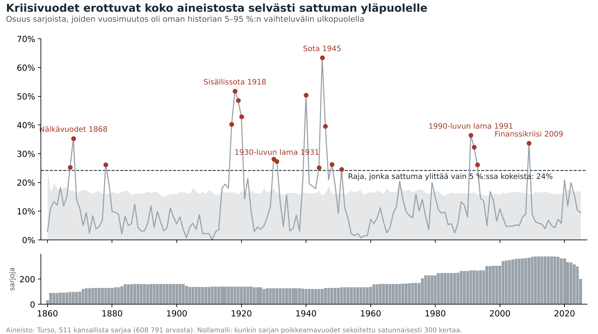
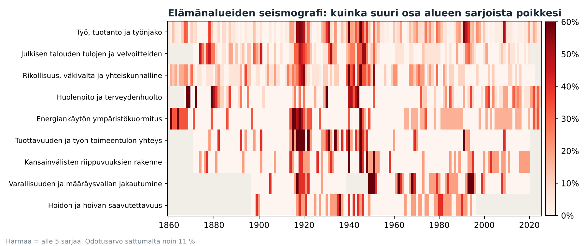

# Koe: toimiiko koko aineiston skannaus?

Kysymys: jos animaatio skannaa kaikki aineiston datapisteet 1850–2025, nouseeko esiin todellisia
muutoksia vai pelkkää sattumaa? Koe ajettiin 25.11.2026 Turson koko indikaattoriaineistolla.
Skriptit: `scripts/skannauskoe/` (`fetch.py` → `analyze.py` → `trend.py` → `figs.py`).

## Aineisto ja menetelmä

- Turson `public__indicator_values`: **608 791 arvoa, 2 426 sarjaa**. Mukaan otettiin havainnot ja
  arviot vuoteen 2025; ennusteet jätettiin pois.
- **511 sarjaa** voitiin analysoida: kansallinen taso ja vähintään 15 peräkkäisten vuosien muutosta.
  Pois jäivät 1 368 vain alueittaista tai useaan ryhmään jaettua sarjaa sekä 547 liian lyhyttä tai
  harvaa sarjaa (esim. väestölaskennat).
- **Poikkeama** = vuosimuutos sarjan oman historian 5–95 %:n vaihteluvälin ulkopuolella, kuten
  /poikkeamat-näkymässä. Määritelmän mukaan noin 11 % kaikista vuosimuutoksista on poikkeamia.
- **Nollamalli:** kunkin sarjan poikkeamavuodet sekoitettiin satunnaisesti sen omien vuosien kesken
  300 kertaa. Näin saadaan, kuinka suuri osa sarjoista poikkeaisi samana vuonna pelkästä sattumasta.
  Raja, jonka sattuma ylittää minä tahansa vuonna vain 5 %:ssa kokeista, on **24 %**.

## Tulos 1: shokit erottuvat selvästi

Rajan ylittivät vuodet 1867–68 (nälkävuodet), 1878, 1917–20 (sisällissota ja sen jälkeiset vuodet),
1930–31 (lama), 1940, 1944–46, 1948, 1951 (sota ja jälleenrakennus), 1991–93 (lama) ja 2009
(finanssikriisi). Huippu oli 1945, jolloin 63 % sarjoista poikkesi; sattumalta odottaisi 11 %.
Muina vuosina osuus pysyi sattuman vaihteluvälillä. Koronavuosi 2020 (21 %) ja 2022 (20 %) jäivät
juuri rajan alle.

**Johtopäätös:** koko aineiston skannaus ei ole kohinaa. Kriisit näkyvät, ja tavalliset vuodet eivät
täyty vääristä hälytyksistä, kun osuutta verrataan sattuman tasoon eikä nollaan.

## Tulos 2: elämänalueet kertovat, mihin kriisi osui

Kaista per teema näyttää, mitkä alueet reagoivat. Esimerkiksi vuonna 1991 poikkeamia oli eniten
työn ja tuotannon sarjoissa (58 %), vuonna 1945 rikollisuuden (89 %) ja työn (80 %) sarjoissa ja
vuonna 2009 työn (49 %) ja alueiden (48 %) sarjoissa. Tämä on animaatiolle hyvä taustakuvio.

## Tulos 3: hidas muutos ei näy poikkeamina

Syntyvyyden lasku 2010–2024 ei näy poikkeamaskannauksessa. Perhe- ja syntyvyysteeman sarjoissa
poikkeamien osuus oli 10 % eli sattuman tasolla, ja muissa sarjoissa 9 %. Lasku oli tasainen eikä
äkillinen, joten mikään yksittäinen vuosimuutos ei ollut poikkeuksellinen.

Kokeiltiin toista tunnistinta, joka etsii **käänteitä**: vuosia, joina viiden vuoden suunta vaihtuu
ja muutos on sarjan suurimpien 10 %:n joukossa. Se löysi kokonaishedelmällisyysluvun käänteen
**2008–2010**, eli juuri syntyvyyden laskun alun. Koko aineistossa käänteiden rajan ylittivät
1918, 1928–1945 ja 1989–1995; vuosi 2010 ei ollut koko aineiston käännevuosi, koska käänne koski
lähinnä syntyvyyttä eikä laajasti muita alueita.

**Johtopäätös:** skannaukseen tarvitaan kaksi tunnistinta: poikkeamat shokeille ja käänteet hitaille
rakennemuutoksille. Yksi ei riitä.

## Tulos 4: aineiston luokittelu ei vielä kanna kysymyksiä

- Teemaan "Perhe ja syntyvyys" kuului vain **7 analysoitavaa sarjaa**, eikä yksikään niistä ollut
  syntyvyys. Kokonaishedelmällisyysluku on luokiteltu teemoihin "Väestörakenne…" ja "Väestö ja
  terveys". Kysymyksen mukainen rajaus teeman perusteella ei siis nyt löytäisi oikeita sarjoja.
- Sama ilmiö on aineistossa useana versiona (esim. kokonaishedelmällisyysluku Gapminderista,
  Tilastokeskukselta ja Pohjoismaiden vertailuna). Kaksoiskappaleet voimistavat samanaikaisia
  poikkeamia keinotekoisesti.
- Atlaksen muuttujia on 32, ja ne ovat laajoja (esim. "Tuottavuuden ja työn toimeentulon yhteys",
  704 sarjaa). Kysymyksen rajaukseen ne ovat liian karkeita.
- 1 368 sarjaa on vain alueittain. Ne voisi tuoda mukaan laskemalla kansallisen tason tai
  käsittelemällä alueet omina kaistoinaan.

## Arvio lähestymistavasta

| Vaatimus | Toimiiko nyt? |
|---|---|
| Kriisien tunnistaminen koko aineistosta | **Kyllä**, selvästi sattuman yläpuolella |
| Elämänalueiden erottelu | **Kyllä**, taustakuvioksi riittävä |
| Hitaiden rakennemuutosten tunnistaminen | **Osittain**: tarvitaan käännetunnistin |
| Kysymyksen mukainen rajaus | **Ei vielä**: teemaluokitus ja kaksoiskappaleet on korjattava |
| Selitysarviot | **Ei aineistosta**: vaativat testit, kuten syntyvyydelle tehtiin käsin |

## Suositeltu jatko

1. **Kaksi tunnistinta** samaan skannaukseen: poikkeamat (shokki) ja käänteet (rakennemuutos),
   molemmat sattuman tasoon suhteutettuina.
2. **Sarjojen siivous:** sarjoille käsitekytkentä, joka vastaa kysymyksiä (esim. syntyvyys,
   nuorten työ, asuminen), ja kaksoiskappaleiden merkintä yhdeksi ilmiöksi.
3. **Animaation rakenne:** koko aineisto taustan seismografina, kysymyksen sarjat korostettuna ja
   selitysarviot vain sinne, missä testi on tehty.
